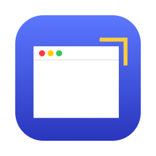

# mac-window-corners

**Window Corners** is a small native app for macOS Tahoe that lets you change the corner radius of app windows. You can make them sharp, subtle, classic, or anything from 0 to 30 pt.

<p align="center"></p>

macOS Tahoe (26) rounds window corners heavily: 16 pt for a plain window and 26 pt for a window with a toolbar. System Settings has no option to change this. However, AppKit reads a hidden user default that overrides the radius. This app gives that default a simple GUI.

- **No SIP changes and no code injection.** The app only writes two keys to your global preferences.
- **Live preview, presets and a radius slider.** Presets are Sharp, Subtle (4 pt) and Classic (10 pt).
- **Optional panel support.** You can choose whether panels and utility windows follow the same radius.
- **Apps to restart.** The app lists running apps that still use the old radius, each with a **Restart** button.

> [!WARNING]
> **Use at your own risk.** This project changes private, undocumented macOS preferences that Apple does not support. It is provided as-is, with no warranty of any kind. The author accepts no responsibility for any damage, data loss, instability, or other problems that result from using it. That includes unsaved work lost when apps are restarted. Back up your Mac before using it, and only use it if you understand and accept these risks.
>
> This project is not affiliated with, endorsed by, or supported by Apple Inc. macOS, AppKit and Liquid Glass are trademarks of Apple Inc.

## Requirements

- macOS 26 (Tahoe) or later, on Apple silicon
- Xcode or the Command Line Tools, to build from source

## Build and install

```bash
cd WindowCorners
./build.sh            # builds "build/Window Corners.app"
./build.sh --install  # builds and copies it to ~/Applications
```

The app is ad-hoc signed, so build it on the Mac where you'll run it.

## Using it

1. Open **Window Corners**.
2. Turn on **Custom window corners**, pick a radius, then click **Apply to All Apps**.
3. Restart apps from the **Apps to restart** list, or log out and back in. Each app reads the setting once, when it launches.

To go back to the macOS default, turn the toggle off and apply.

## Without the app

The app is a front end for these commands:

```bash
defaults write -g NSConvolutionOverride1 -float 0.01   # windows, sheets, alerts
defaults write -g NSConvolutionOverride2 -float 0.01   # panels and utility windows

# Undo
defaults delete -g NSConvolutionOverride1
defaults delete -g NSConvolutionOverride2
```

AppKit ignores a value of `0`, so `0.01` is used for sharp corners.

## How it works

`-[NSThemeFrame _getCachedWindowCornerRadius]` decides each window's radius. Before it falls back to its built-in Tahoe values, it asks `-[NSThemeFrame _convolutionOverride]`. That method reads `NSConvolutionOverride1` (or `NSConvolutionOverride2` for utility windows) from `NSUserDefaults`, and uses the value if it is non-zero. The radius then sets the size of the corner mask that AppKit hands to WindowServer.

The full reverse-engineering notes are in [macos-tahoe-window-corner-radius.md](macos-tahoe-window-corner-radius.md). They cover the call chain, reconstructed pseudocode, verification and open questions.

## Limitations

- **Content inside a window can stay rounded.** Only the window's outer shape changes. Some Liquid Glass elements, such as sidebars, keep their own minimum radius.
- **Not every app is affected.** Apps that draw their own window frame are unaffected. Examples are frameless Electron windows and some browsers.
- **The key is private and undocumented.** A future macOS update may remove it.
- **Apple may see the setting.** AppKit reports non-standard values of this setting to Apple's analytics, if analytics sharing is turned on.

## License

[MIT](LICENSE). The software is provided "as is", without warranty of any kind. See the disclaimer above.
